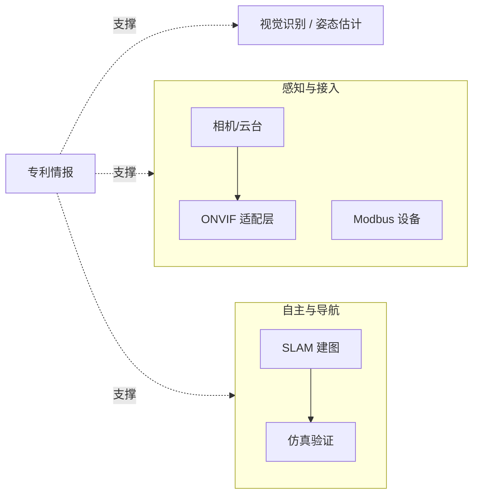

# embodied-robotics-hub

  

具身智能（Embodied AI）与巡检机器人研发工具集索引：把 [linuxsuren](https://github.com/linuxsuren) 名下分散的机器人相关公开仓库——导航、相机、视觉识别、设备接入、专利——按研发链路串联起来，方便一站式找到能直接用的工具。

## 🗺️ 研发链路全景

## 📦 仓库索引

### 导航与 SLAM

| 仓库 | 简介 | 技术栈 |
|---|---|---|
| [awesome-slam](https://github.com/linuxsuren/awesome-slam) | 精选 SLAM 资源收录：视觉/激光 SLAM 系统、优化框架、数据集、评估工具 | — |
| [ros-sim-desktop](https://github.com/linuxsuren/ros-sim-desktop) | ROS 2 仿真桌面运行时镜像（rviz2 / Gazebo Classic + VNC + noVNC），amd64/arm64 多架构 | Shell / Docker |

### 相机与视频接入

| 仓库 | 简介 | 技术栈 |
|---|---|---|
| [onvif-go](https://github.com/linuxsuren/onvif-go) | Golang 的 ONVIF 协议实现 | Go |
| [local-onvif-adapter](https://github.com/linuxsuren/local-onvif-adapter) | 把本地摄像头（内置/USB）暴露为标准 ONVIF 设备，内嵌 RTSP 服务器与 Web 管理台 | Go + Vue |
| [skydroid-onvif-adapter](https://github.com/linuxsuren/skydroid-onvif-adapter) | 云卓云台相机 → 标准 ONVIF 设备：PTZ 翻译为 TP 协议，支持姿态回报与预置位 | Go |
| [ysc6c-onvif-adapter](https://github.com/linuxsuren/ysc6c-onvif-adapter) | 萤石 C6C 云端摄像机 → 标准 ONVIF 设备（云端 API 转 ONVIF，补齐 NVR 接入能力） | Python |
| [cmcc-onvif-adapter](https://github.com/linuxsuren/cmcc-onvif-adapter) | 中国移动和家亲 CMCC V31S 云端摄像头 → 标准 ONVIF 设备 | Python |
| [ios-ipcam-streamer](https://github.com/linuxsuren/ios-ipcam-streamer) | iPhone/iPad 内置摄像头转 IP 摄像头网关：RTSP / HTTP(MJPEG) / ONVIF 三协议，多摄并发推流 | Swift |
| [ohos-ipcam-streamer](https://github.com/linuxsuren/ohos-ipcam-streamer) | 鸿蒙手机摄像头转 IP 摄像头网关（RTSP + ONVIF），H.264 硬编码 | C |
| [tv-uvc-streamer](https://github.com/linuxsuren/tv-uvc-streamer) | Android 设备摄像头转流网关：USB UVC 与内置多摄 → MJPEG / RTSP / ONVIF | Java |
| [robot-viewer](https://github.com/linuxsuren/robot-viewer) | 浏览器内机器人模型查看器：URDF/Xacro + STL/OBJ/DAE/GLB，关节面板联动 | React + Three.js |
| [onvif-ai](https://github.com/linuxsuren/onvif-ai) | ONVIF IP 相机 AI 语音助手：实时 RTSP 视频 + 语音识别 + LLM 问答 + TTS 播报 | Go + Vue 3 |

### 视觉识别与 AI

| 仓库 | 简介 | 技术栈 |
|---|---|---|
| [open-fitpose-server](https://github.com/linuxsuren/open-fitpose-server) | 开源健身/运动姿势视觉识别服务端：WebSocket 流式姿态识别、动作计数与纠错 | Go |
| [open-fitpose-android](https://github.com/linuxsuren/open-fitpose-android) | 姿势识别 Android 客户端：CameraX + WebSocket 流式识别 | Kotlin |
| [open-fitpose-ohos](https://github.com/linuxsuren/open-fitpose-ohos) | 姿势识别鸿蒙客户端：ArkTS + WebSocket 流式识别 | ArkTS |

### 设备与数据接入

| 仓库 | 简介 | 技术栈 |
|---|---|---|
| [modbus-hub](https://github.com/linuxsuren/modbus-hub) | 自托管 Modbus 采集网关：统一读写 Modbus TCP 与串口 RTU（RS485/RS232）设备，转发 MQTT 或 TCP JSON 流，Go 单二进制内嵌 Web 管理台 | Go |
| [atest-ext-store-ros2](https://github.com/linuxsuren/atest-ext-store-ros2) | [api-testing](https://github.com/linuxsuren/api-testing) 的 ROS 2 数据存储扩展 | Go |
| [atest-ext-store-mqtt](https://github.com/linuxsuren/atest-ext-store-mqtt) | api-testing 的 MQTT 存储扩展 | Go |
| [atest-ext-store-iotdb](https://github.com/linuxsuren/atest-ext-store-iotdb) | IoTDB 时序数据库 Web 客户端与存储扩展 | Go |

### 专利情报

| 仓库 | 简介 | 技术栈 |
|---|---|---|
| [awesome-patent](https://github.com/linuxsuren/awesome-patent) | 具身智能与巡检机器人专利精选：按技术领域与公司双维度收录，附 Mermaid 全景脑图 | — |
| [graph-patent](https://github.com/linuxsuren/graph-patent) | 专利力导向图查询与展示：专利—公司—技术领域三层图谱，数据来自 awesome-patent | Vue |

> 💡 巡检平台（robot-platform 系列）、导航系统（device-robot-navigation）等核心工程仓库目前为私有，暂未收录；开源后将持续补充到本索引。

## 🤝 贡献

- 发现收录缺失或描述不准确？欢迎提 [Issue](https://github.com/linuxsuren/embodied-robotics-hub/issues) 或 PR。
- 新增条目请保持「一句话准确描述 + 技术栈」的格式，按所属领域归类。
- 欢迎贡献具身智能相关的其他优质资源（不限于 linuxsuren 名下仓库），但请确保与研发链路直接相关。

## License

[Apache-2.0](LICENSE)
